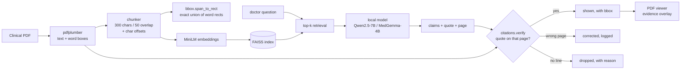

# EUNOCURA

**An open-weight clinical document intelligence harness.**

Point it at a medical PDF. It extracts structured clinical facts, answers questions
about the document, and — the part that matters — **refuses to show a claim it cannot
quote from the page it cites.**

Zero API keys. Zero paid services. Runs on a laptop, offline.

```
claim offered by the model  →  "TLC 14,200 per microlitre"  · page 2
claim shown to the doctor   →  only if page 2 really says that
otherwise                   →  dropped, with the reason printed
```

---

## 1. The rule the project is built on

> **Citation-or-drop.** A claim survives only if a line it quotes actually exists on
> the page it cites. No quote, no claim. Wrong page, we fix the page or drop it.

That check is **plain string work in Python**, in `backend/src/services/citations.py`.
It never runs through a model. The model's only job is to *offer* claims with a quote
and a page number; `verify()` decides whether that offer is worth showing to a doctor.
Each surviving claim gets the exact bounding box of the words it rests on, so the PDF
viewer can point at the line instead of paraphrasing it.

This is the part a judge can break on purpose and watch hold.

---

## 2. Models

Every model is open-weight. Nothing is called unless it is installed locally, except
the optional Gemini fallback which is off by default.

| Role | Model | Params | Licence | Where |
|---|---|---|---|---|
| Extraction, intent, chat (default) | [`Qwen/Qwen2.5-7B-Instruct`](https://huggingface.co/Qwen/Qwen2.5-7B-Instruct) | 7B | Apache-2.0 (OSI) | `OLLAMA_SLM_MODEL` |
| Clinical reasoning (default) | [`google/medgemma-4b-it`](https://huggingface.co/google/medgemma-4b-it) | 4B | Health AI Developer Foundations terms — **open weights, not OSI** | `OLLAMA_MED_MODEL` |
| Embeddings | [`sentence-transformers/all-MiniLM-L6-v2`](https://huggingface.co/sentence-transformers/all-MiniLM-L6-v2) | 22M | Apache-2.0 (OSI) | `pdf_rag.py` |
| Optional cloud fallback | [`google/gemma-3-27b-it`](https://huggingface.co/google/gemma-3-27b-it) family via Gemini API | 27B | Gemma Terms of Use — **open weights, not OSI** | `LLM_PROVIDER=gemini` |
| Historical (not used by default) | [`m42-health/Llama3-Med42-70B`](https://huggingface.co/m42-health/Llama3-Med42-70B) | 70B | Llama 3 Community Licence + Med42 terms | replaced by the local `med` profile |

**Licence honesty:** the code is MIT (`LICENSE`). The *models* are not all OSI — two of
them carry custom open-weight terms. Pulling a model means accepting its provider terms;
EUNOCURA does not redistribute weights.

**Ollama tags.** `OLLAMA_MED_MODEL` ships as `medgemma:4b`. If that tag is not on your
Ollama registry, set it to any medical model you have pulled (for example
`ollama pull llama3.1:8b`) — the profile is a config value, not a hard dependency.

### Why local

A hospital cannot paste a discharge summary into a public API to find out what it says.
Local open weights are the only version of this product that could ever be deployed.
It also means the demo works when the venue wifi does not.

---

## 3. Quick start (no keys)

### Windows PowerShell

```powershell
# 1. Models (optional - run when Ollama is installed)
ollama serve
ollama pull qwen2.5:7b-instruct
ollama pull medgemma:4b          # or any medical model you prefer

# 2. Backend
cd backend
python -m venv .venv
.\.venv\Scripts\python.exe -m pip install -r requirements.txt
Copy-Item .env.example .env                       # zero-key offline defaults
.\.venv\Scripts\python.exe scripts\preflight.py    # health check
.\.venv\Scripts\python.exe -m uvicorn src.server:app --port 8000

# 3. Frontend (in a separate terminal)
cd frontend
npm install
Copy-Item .env.example .env                       # default VITE_API_BASE_URL=http://localhost:8000
npm run dev
```

### Linux / macOS

```bash
# 1. Models
ollama serve
ollama pull qwen2.5:7b-instruct
ollama pull medgemma:4b

# 2. Backend
cd backend
python3 -m venv .venv
source .venv/bin/activate
pip install -r requirements.txt
cp .env.example .env
python scripts/preflight.py
python -m uvicorn src.server:app --port 8000

# 3. Frontend
cd ../frontend
npm install
cp .env.example .env
npm run dev
```

Then:

* `http://localhost:8000/healthz` — model / Mongo / storage / STT / RAG status
* `http://localhost:8000/docs` — OpenAPI documentation
* `http://localhost:3000` (or `http://localhost:5173`) — doctor and patient portals

**Nothing above requires an account, a card or an API key.** If `ollama` is absent the API
still boots and `/healthz` says `degraded` with the exact command to fix it.
MongoDB is the same: absent means the portals show degraded status, not that the server dies.

### Degrade matrix

| Subsystem | If missing or offline | System behavior |
|---|---|---|
| **Ollama / Models** | Service unreachable or models unpulled | `/healthz` reports `model: false` (degraded); chat routes return HTTP 503 with exact startup hints; offline citation verification still runs. |
| **MongoDB** | `MONGODB_URI` not configured or mongod stopped | `/healthz` reports `mongo: false`; data routes return HTTP 503; frontend displays amber fixture notices on demo screens. |
| **R2 Storage** | Cloud credentials omitted | Files save to local disk (`backend/data/uploads`), served at `/files/<name>`. |
| **Speech-to-Text** | `faster-whisper` not installed | Text-only mode; voice routes return HTTP 503 with pip command; system TTS (`pyttsx3`) continues working. |
| **Vector Embeddings** | Windows WDAC restriction on `_check_build.pyd` | Vector RAG reports unavailable via `/healthz`; deterministic extraction, citation verifier, and bbox highlight engine operate 100% offline. |

---

## 4. What is real, and what is a fixture

Judges can test both portals. Every screen that is not wired to a live backend displays
an amber notice in the UI.

### Real — backend + frontend

| Feature | Implementation |
|---|---|
| **Auth** | JWT (HTTPBearer), Argon2 hashing, 7-day tokens, HTTP 503 when DB offline |
| **Appointments** | CRUD + status transitions, MongoDB with degraded fallback |
| **Patient records** | MongoDB, access checked per doctor–patient relationship |
| **Document extraction** | pdfplumber → model → structured clinical JSON |
| **Citation verification** | `services/citations.py` — claim kept only if its quote exists on the cited page; wrong-page claims corrected; the rest dropped |
| **Exact highlight boxes** | chunk → character span → union of pdfplumber word rects (`services/bbox.py`). No ±50 pt guessing |
| **Evidence PNG rendering** | PyMuPDF highlight rendering with exact coordinates |
| **Document RAG** | FAISS + MiniLM embeddings, per-document index |
| **AI diagnosis** | `med` profile over patient context, differential with confidence |
| **Patient chatbot** | `slm` profile, 11 Indic languages + English, optional voice |
| **Speech-to-text** | local faster-whisper; text-only degrade if absent |
| **File storage** | R2 if configured, else local disk served by the API |
| **Health / preflight** | `/healthz` + `scripts/preflight.py` with capped probes |

### Fixture data — labelled in the UI

| Screen | Status |
|---|---|
| Medications | `src/data/dummyData.js` — amber "Interactive preview · fixture data" banner |
| Diet plan | same banner |
| Notifications | same banner |
| Test result charts | same banner; upload/OCR not implemented |

---

## 5. Agent Skill

The document intelligence core is packaged as an Agent Skill following the [Agent Skills standard](https://agentskills.io/specification):

```
.agents/skills/clinical-document-intelligence/
├── SKILL.md                  # Specification-compliant manifest
├── scripts/
│   ├── build_index.py        # PDF → chunks + FAISS index
│   ├── query_pdf.py          # question → chunks with page + bbox (+ evidence PNG)
│   └── extract_clinical.py   # PDF → structured JSON, verified citation-or-drop
├── references/
│   └── extraction-schema.md  # JSON Schema the model must satisfy
└── assets/
    └── sample-discharge-summary.pdf
```

Execute the skill directly via CLI:

```powershell
.\backend\.venv\Scripts\python.exe .agents\skills\clinical-document-intelligence\scripts\extract_clinical.py `
  --pdf .agents\skills\clinical-document-intelligence\assets\sample-discharge-summary.pdf `
  --claims backend\tests\fixtures\test_claims.json
```

Outputs verified clinical claims with status (`supported`, `page_corrected`, `dropped`) and exact coordinates.

---

## 6. Architecture



The verifier sits *beside* the model, not inside it. Removing the model leaves a tool
that can still split, index and verify; removing the verifier leaves an untrustworthy one.

---

## 7. API Routes

| Method | Path | Purpose |
|---|---|---|
| `GET` | `/` | Root service metadata |
| `GET` | `/healthz` | Subsystem status probe for live demo |
| `POST` | `/auth/signup/patient` | Patient registration |
| `POST` | `/auth/signup/doctor` | Doctor registration |
| `POST` | `/auth/login` | JWT access token issuance |
| `GET` | `/auth/me` | Current authenticated user profile |
| `GET` | `/patients/` | Search & list patients (doctor auth) |
| `GET` | `/patients/{patient_id}` | Patient record by ID (doctor auth) |
| `GET` | `/appointments/` | Appointment listing by date/doctor/patient |
| `POST` | `/appointments/` | Book / schedule appointment |
| `POST` | `/appointments/{appointment_id}/diagnosis` | AI differential diagnosis from patient context |
| `POST` | `/doctors/chat` | Grounded Q&A over patient history or uploaded PDF |
| `POST` | `/doctors/upload-pdf` | Upload PDF for chat context |
| `GET` | `/doctors/pdf/{document_id}` | Download uploaded PDF safely |
| `POST` | `/chatbot/text` | Multilingual patient health assistant |
| `POST` | `/chatbot/voice` | Voice-to-voice patient interaction |
| `POST` | `/chatbot/speak` | Text-to-speech synthesis |
| `POST` | `/ingest/document/{appointment_id}` | PDF ingestion & clinical extraction |
| `GET` | `/files/{file_path}` | Local static file fallback |

---

## 8. Tests & Verification

```powershell
cd backend

# 1. Verifier: 28 edge cases (normalization, quotes, drop reasons)
.\.venv\Scripts\python.exe tests\test_citations.py

# 2. Geometry: 29 coordinate tests (spans, unions, clamping)
.\.venv\Scripts\python.exe tests\test_bboxes.py

# 3. Integration: 15 checks on synthetic discharge summary & PNG render
.\.venv\Scripts\python.exe tests\test_pdf_e2e.py

# 4. Agent Skill: 22 checks for Agent Skills specification compliance
.\.venv\Scripts\python.exe tests\test_agent_skill.py

# 5. Connection & Resilience: 6 checks for degraded mode & error handling
.\.venv\Scripts\python.exe tests\test_backend_connection.py

# 6. Preflight diagnostic:
.\.venv\Scripts\python.exe scripts\preflight.py

# 7. Frontend build:
cd ..\frontend
npm run build
```

**100 / 100 test checks passing** offline without requiring API keys or external clouds.

---

## 9. Limits & Clinical Disclaimer

* **Not a medical device.** No regulatory clearance, no clinical validation. It is a
  document-reading harness for demonstration purposes, and the UI states this explicitly.
* Verification proves *the document says it*, not *the document is clinically correct*. A wrong lab
  value quoted accurately from a chart is still shown — with its exact box, so a human clinician can judge it.
* The default 4B medical model is compact. It will miss things. That is why every claim
  is quotable and every quote is verifiable.

---

## 10. Licence

MIT — see `LICENSE`. Model weights retain their own respective provider licences (see §2).
